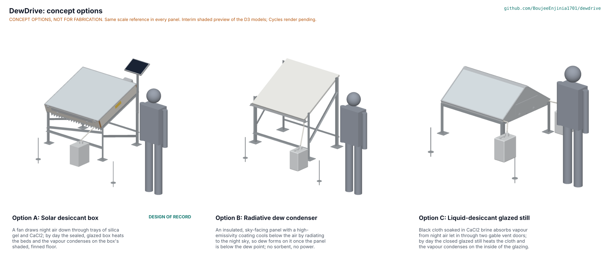

# DewDrive concept options

On the weighted scores alone, option B (a radiative dew condenser) scores 120 of 170, option A (the current solar desiccant box) 117 and option C (a liquid-desiccant glazed still) 90. Because A and B are within 10 %, both go to Amish without a pick (STANDARDS section 21). The totals hide one fact that matters more than any other row: at the design point (20 °C and 40 % night RH) option B makes no water at all, because a sky-cooled panel cannot get below the 6 °C dew point (DWD-STM-001, B1 and B2). Option A stays the design of record until Amish decides (DWD-DDR-004, "Proposed, awaiting Amish"). Method: STANDARDS section 21. The three options share the 1.1 by 1.0 m footprint of the current design, so they are compared at one size.

*Figure 1. The three options, each modelled at detail level D3 in `cad/src/model.py` (option A) and `cad/src/dwd_options.py` (options B and C), with a 1.75 m person for scale. The picture in the repository is an interim shaded preview; the Cycles render is made on Amish's Mac with `python .kit/options.py`.*

## The options

### Option A: solar desiccant box (current design)

A fan draws night air down through four trays of silica gel loaded with 25 wt % CaCl₂; by day the sealed, glazed box heats the beds and the vapour condenses on the box's shaded, finned floor. This is the design of record of DWD-PRC-001, as made buildable in DWD-DDR-003 and corrected by the STEM check and its independent review of 2026-10-25 (black absorber plates on the beds, PTFE-coated brine-wetted parts, an open tray floor, a painted condenser underside, stronger anchors; DWD-DEC-001, D16 to D20). It collects about 0.44 L per day at 40 % night RH, short of the 0.5 L target, and 0.31 L at 25 % (DWD-CAL-001, C3 and C4) for an estimated $695 in parts. It needs a 10 W PV panel, a small LiFePO4 battery and a 2 W fan, and its bed runs at about 105 °C at noon. Key risks: PR-001 not met on paper, the composite's real isotherm and kinetics, seal leakage, and the hot interior. From a co-design partner it needs site humidity and sun data and a test site.

### Option B: radiative dew condenser

An insulated aluminium panel 1.1 by 1.0 m with a white, high-emissivity coating faces the night sky at 30°. It radiates to the sky and runs about 9 to 10 K below the air on a clear, calm night (DWD-STM-001, B1), so dew forms on it whenever the panel is below the dew point and runs into a gutter and a jerrycan. It has no sorbent, no power and no moving parts: a welded aluminium frame, a 27 mm foam board, the coated sheet, a galvanized stand, a gutter and a jerrycan (`cad/src/dwd_options.py`, option_b). At 20 °C and 40 % RH the dew point is 6.1 °C and the panel stays near 10 °C, so it collects nothing; it starts to work at about 55 to 60 % RH and field data show little dew below about 71 % RH (Atashi et al., 2021). In arid and semi-arid zones, plane radiative condensers collect typically 0.2 to 0.6 L per m² on nights with dew (same source). Key risks: no water in the dry season, which is when users need it most; dust and bird droppings on an open collecting surface. From a partner it would need a humid-night climate record.

### Option C: liquid-desiccant glazed still

Black cotton cloth on three shelf tiers is soaked with about 9 kg of 30 wt % CaCl₂ brine in a black HDPE tray, under a fixed glazed gable roof on cut-and-folded aluminium gable plates. At night two vent doors in the gables are opened and the brine absorbs vapour from the air; by day the doors are shut, the sun heats the cloth and the vapour condenses on the inside of the glazing and runs into eave channels and two jerrycans (`cad/src/dwd_options.py`, option_c). It follows the multi-shelf solar glass pyramid of Kabeel (2007), who reported about 2.5 L per m² per day under test conditions the paper does not state. At the design point the physics is much less kind, and very sensitive to how hot the cloth gets: brine can only be dried until its vapour pressure at cloth temperature equals saturation at the glazing. With the glazing at 50 °C that is about 52 wt % with the cloth at 80 °C but only 44 wt % at 70 °C, against 40 wt % in equilibrium with 40 % RH night air. Natural convection then lets the cloth take up about 0.7 kg or 0.27 kg overnight, and about 0.5 or 0.2 L per day reaches the jerrycans (DWD-STM-001, C1 to C3; the mass-transfer coefficient and the collection efficiency are estimates). At 25 % RH the brine gives water up to the air at night and the still makes almost nothing. Key risks: free brine on cloth and in a tray (spills, creep into the condensate channels, corrosion), cloth decay, and the daily routine of two doors. From a partner it would need a brine-handling and water-testing plan.

## First-order numbers

Table 1. Options compared. Part counts and model masses are from `cad/fidelity.json` (the masses there use the parts library's standard densities, so option A's model mass is higher than the 61.1 kg of DWD-CAL-001, which uses the real foam, sorbent and catalogue masses).

| Quantity | Option A | Option B | Option C |
| --- | --- | --- | --- |
| Estimated parts cost (USD) | 695 (priced BOM, DWD-CAL-001 J1) | about 230 (estimate: stand 45, aluminium sheets 70, foam 15, radiative paint 20, frame 20, gutter and drain 20, jerrycan 12, hardware 25) | about 445 (estimate: base frame and legs 55, HDPE tray 60, rack and shelves 45, cloth 10, CaCl₂ 15, gable plates 50, glazing and frames 100, channels and cap 20, doors 25, drains and two jerrycans 40, hardware 25) |
| Mass (kg) | 61.1 (DWD-CAL-001 G1); 77.8 in the model | 44.1 in the model | 71.4 in the model, plus about 9 kg of brine |
| Water at 40 % night RH | 0.44 L/day (C3); 0.37 to 0.41 under the sensitivities | 0 (STEM B2) | about 0.2 to 0.5 L/day, cloth at 70 to 80 °C (STEM C1 to C3) |
| Water at 25 % night RH | 0.31 L/day (C4) | 0 | about 0 |
| Energy | Sun only; 23.6 Wh/day for fan and logger from a 10 W panel | None | None |
| Parts count (model) | 427, of which 122 made or bought, 305 fasteners | 102, of which 27 made or bought, 67 fasteners, 8 welds | 169, of which 49 made or bought, 112 fasteners, 8 welds |
| Daily actions | 2 (flaps) | 0 (empty the jerrycan) | 2 (vent doors), plus brine top-up |
| STEM check | Within known science after fixes D16 to D20; 10 rows plausible, 7 of them open to TRL 4 | Within known science; makes no water at the design point | Within known science; small yield at the design point |

## Scoring

Table 2. Weighted scoring (weights: High UR 3, Medium 2, Low 1; scores 1 to 5). The template's extra criteria are covered by the user requirements they duplicate: cost by UR-010, buildability by UR-009 and safety by UR-004, UR-005 and UR-012; maintenance is added at weight 1.

| Criterion | Source | Weight | A | B | C | Reason |
| --- | --- | --- | --- | --- | --- | --- |
| Daily water in the dry season | UR-001 | 3 | 3 | 1 | 3 | A 0.44 L/day, short of the 0.5 target; B nothing at 40 % RH; C 0.2 to 0.5 L/day, depending on cloth temperature |
| Water on the driest nights | UR-002 | 2 | 4 | 1 | 1 | A 0.31 L/day against 0.25; B and C about nothing at 25 % RH |
| Little daily effort | UR-003 | 3 | 4 | 5 | 3 | A two flap actions; B none; C two doors plus brine care |
| Water I can make safe | UR-004 | 3 | 3 | 3 | 2 | A sealed path, salt kept apart but nearby; B open, dusty collecting surface; C free brine next to the condensate path |
| No harm to people | UR-005 | 3 | 3 | 5 | 3 | A hot interior and a lithium battery; B nothing hot, no chemicals, no battery; C hot brine and glazing |
| Survives an unattended site | UR-006 | 3 | 3 | 4 | 2 | A fan, electronics and seals; B simple, but its coating fouls; C brine, cloth and glazing seals |
| Two people can move and set it up | UR-007 | 2 | 3 | 4 | 2 | A 61.1 kg, box 23.4 kg once emptied; B about 44 kg in two parts; C about 71 kg plus a tray of brine |
| No fuel, no grid | UR-008 | 3 | 4 | 5 | 5 | A sun only but needs PV, battery and fan; B and C fully passive |
| Built and repaired locally | UR-009 | 3 | 3 | 5 | 3 | A sheet metal, coatings and electronics; B one panel and a stand; C HDPE welding and glazing frames |
| Worth the money | UR-010 | 3 | 3 | 1 | 3 | Cost per litre over 5 years: A about $0.87; B no water at the design point; C about $0.50 to $1.20. Against the $520 target: A $175 over, B and C under |
| Comparable yield records | UR-011 | 2 | 5 | 2 | 2 | A logs by design; B and C would need a logger added |
| Salt stays out of the water | UR-012 | 3 | 4 | 5 | 2 | A pores fill only above 71 % RH, sumps as backstop; B no salt; C free brine on cloth and in the tray |
| Maintenance | | 1 | 3 | 4 | 2 | A seals, fan, battery; B cleaning; C brine, cloth and tray |
| **Weighted total (of 170)** | | | **117** | **120** | **90** | |

## Recommendation

**Proposed, awaiting Amish.** Options B (120) and A (117) are within 10 % on the weighted total, so under STANDARDS section 21 both go to Amish without a pick, and option A stays the design of record until he decides (DWD-DDR-004; DWD-DEC-001, open item 1).

Two facts for the decision:

- **Option B makes no water when it is needed.** Its high scores come from what it lacks (no heat, no salt, no power, few parts), but at the design point it collects nothing, and the rows that reward simplicity cannot make up for that. If UR-001 is treated as a pass or fail gate, as its role as the product's reason to exist suggests, option B drops out and option A leads option C by 30 %. Option A itself now misses the 0.5 L per day target (0.44 L); recovering it is open item 2 of DWD-DEC-001.
- **Option C is the weakest.** The published yield of the glass pyramid does not carry over to 40 % night RH; its yield swings from 0.2 to 0.5 L per day with a 10 K change in cloth temperature; and free brine near the condensate path is hard to keep out of the water.

The runner-up's best idea is already grafted onto option A: option B's high-emissivity coating, applied to option A's condenser fins and plate underside so that they radiate to the shaded ground as the calculation assumes (DWD-DEC-001, D18). Option C's best idea, passive night ventilation through vents without a fan, is listed in the review note as a suggestion to study for a night mode that saves the battery; it is not adopted.

## Sources

- Atashi, N., D. Rahimi, V. A. Sinclair, M. A. Zaidan, A. Rusanen, H. Vuollekoski, M. Kulmala, T. Vesala and T. Hussein. "Delineation of Dew Formation Zones in Iran Using Long-Term Model Simulations and Cluster Analysis." *Hydrology and Earth System Sciences* 25 (2021): 4719 to 4740. https://hess.copernicus.org/articles/25/4719/2021/hess-25-4719-2021.html (checked 2026-10-25).
- Kabeel, A. E. "Water Production from Air Using Multi-Shelves Solar Glass Pyramid System." *Renewable Energy* 32, no. 1 (2007): 157 to 172. https://ideas.repec.org/a/eee/renene/v32y2007i1p157-172.html (checked 2026-10-25).
- LaPotin, A., Y. Zhong, L. Zhang et al. "Dual-Stage Atmospheric Water Harvesting Device for Scalable Solar-Driven Water Production." *Joule* 5 (2021). https://www.sciencedirect.com/science/article/pii/S254243512030444X (cited in DWD-PRB-001).
- DewDrive STEM check DWD-STM-001 and calculation note DWD-CAL-001 v0.8 for every number above.
